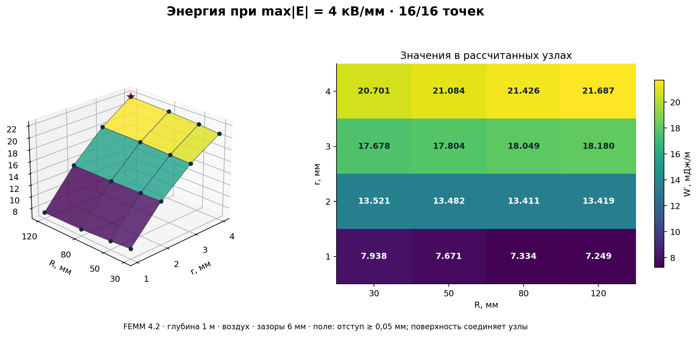
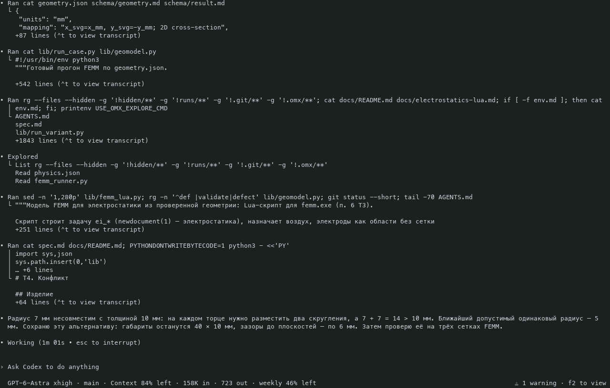

# Галерея эксперимента

[К материалам статьи](../../README.md) · [Условия расчёта](../article/model.md) · [Все 54 сессии](../article/sessions.md)

Три эпизода показывают разные стороны работы: что именно рассчитал агент, как выглядело решение в терминале и почему даже после успешной проверки файлов стоит сверить с ними итоговую реплику.

## T5. Как форма электрода влияет на запасённую энергию

Слева линии соединяют 16 рассчитанных точек, справа подписаны значения в мДж/м. При увеличении радиуса нижнего свода с 30 до 120 мм энергия **падает** в нижней строке (боковое скругление 1 мм), но **растёт** в верхней (4 мм). Лучший из этих вариантов — 21,687 мДж/м при (4, 120) мм. Это максимум на заданной сетке, а не доказательство оптимальности за её пределами.

[Энергия и рабочее напряжение по отдельным сечениям графика](t5-sections.png) · [Сходимость поля при измельчении сетки](t5-convergence.png) · [Числа для всех 16 точек (CSV)](../article/t5-energy.csv).

Источник трёх рисунков — файлы, которые сохранил сам Codex CLI в сессии с библиотекой и профилем студента: `m-codex-C-T5-1/workspace/out/{surface,sections,convergence}.png`. Графики не перестраивались для галереи.

## T4. Что видел бы человек у терминала

Codex CLI распознаёт, что два скругления по 7 мм не помещаются на грани высотой 10 мм. Затем пишет сценарий для проверки альтернативы. На последнем экране агент отвечает на вопрос, что нужно изменить: уменьшить радиус до 5 мм или увеличить толщину проводника.

Это **три подлинных кадра одного запуска**, а не непрерывное видео и не запись рабочего стола: стенд сохранял изображение псевдотерминала. Для удобства чтения кадры показаны с паузами, не в реальном масштабе времени. Источник: `m-codex-C-T4-1/frames/`, кадры 0031, 0061 и 0152.

[Последний экран в полном размере](t4-final.png) · [Тот же финальный вопрос и ответ текстом, из agent.jsonl](t4-agent-excerpt.txt).

## T2. Что было принято и что осталось в файле

В сессии `m-claude-C-T2raw-2` оператор сначала заметил, что в файлах записано **4,4 мм**. В ответ на повторный вопрос ведущего на *том же ходу* он принял **4,60 мм**. Это не два сообщения, между которыми исполнитель изменил геометрию. Их можно сравнить с сохранённым контуром самостоятельно:

1. [Две реплики оператора (JSONL)](t2-operator-excerpt.jsonl) — тексты приведены полностью; из записей оставлены только номер хода и реплика.
2. [Сданная геометрия (JSON)](t2-geometry.json) — у объекта `strip_conductor` в группе `radii` все четыре значения равны 4.4.

## Где полные логи

В локальном архиве всех 54 выбранных сессий есть `agent.jsonl` (задание и события хода исполнителя) и `executor/raw.ansi` (сырой поток терминала). Это **разные записи**: первый файл не является полной стенограммой команд и ответов. Файл `operator.jsonl` существует в 47 сессиях; это журнал отдельной модели-пользователя, в нём возможны и записи без текста. У всех 54 сессий есть каталог кадров. Одноимённые `session.gif` во всех 54 случаях содержат лишь по одному кадру; для примера выше использованы исходные PNG.

В Git не включается весь каталог `runs/`. В галерее лежат только отобранные материалы, которые можно открыть без локального архива. Для полной проверки журналы лучше распространять отдельным версионированным архивом по [индексу сессий](../../analysis/runs.json), после проверки на ключи, домашние пути, имена учётных записей и другие сведения рабочей машины. Такого публичного архива пока нет.
